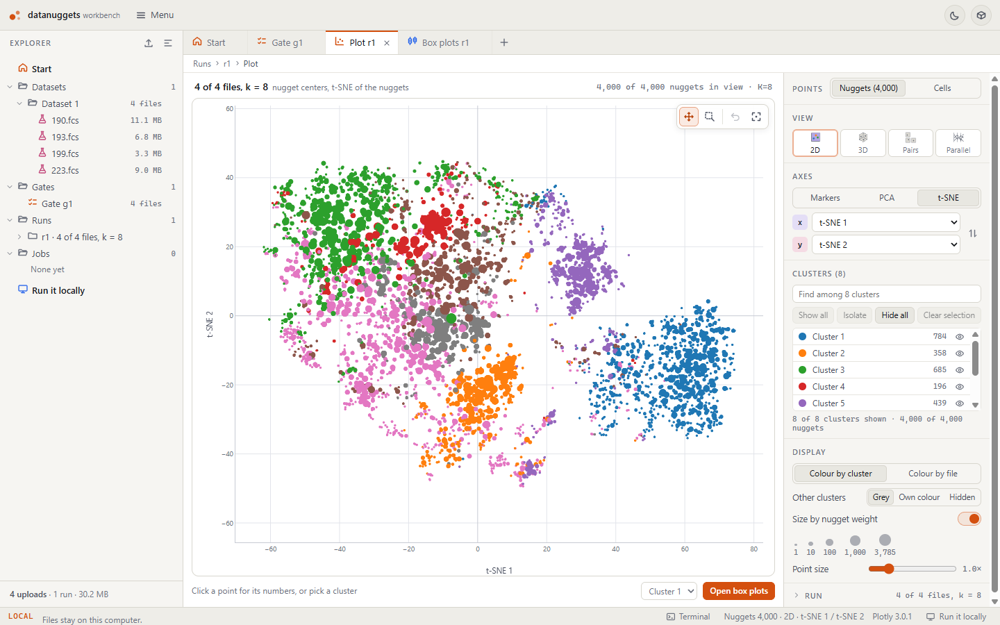
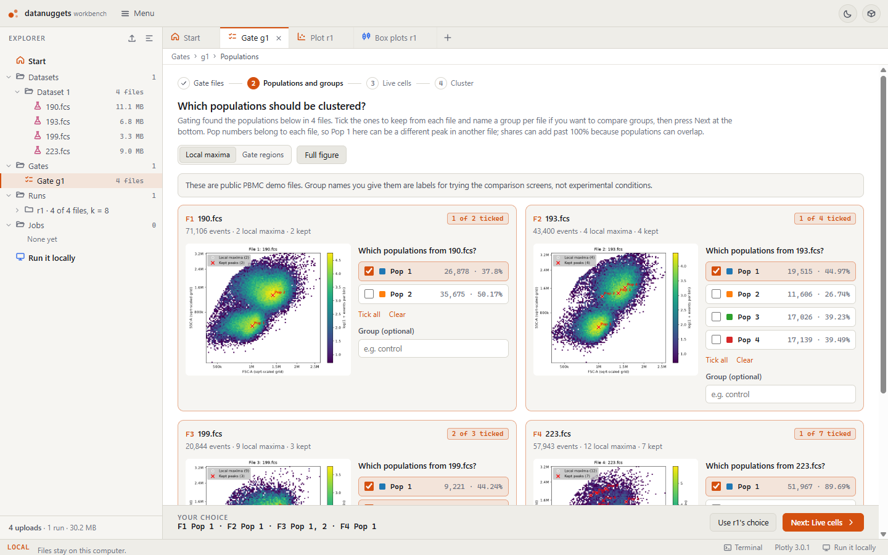
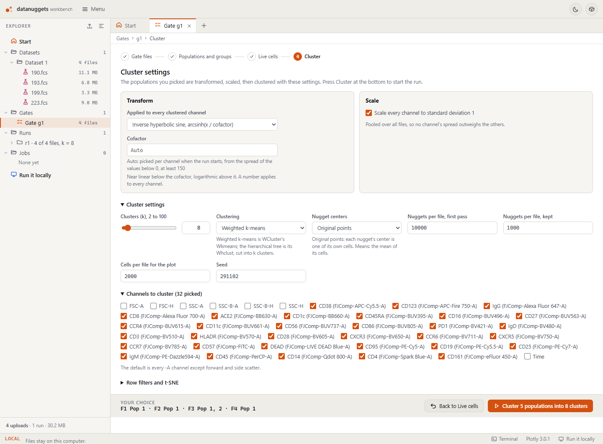
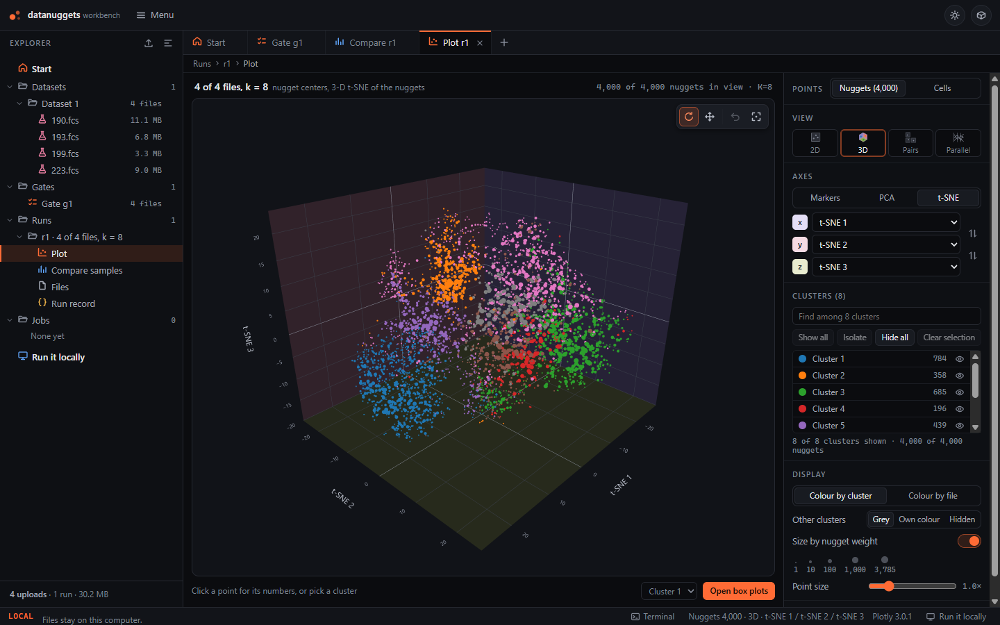
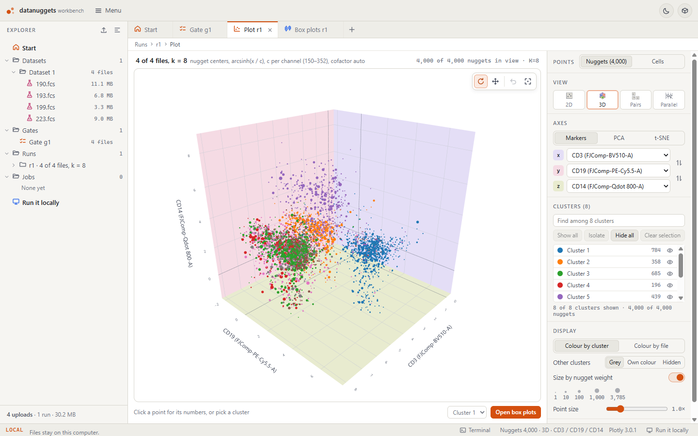
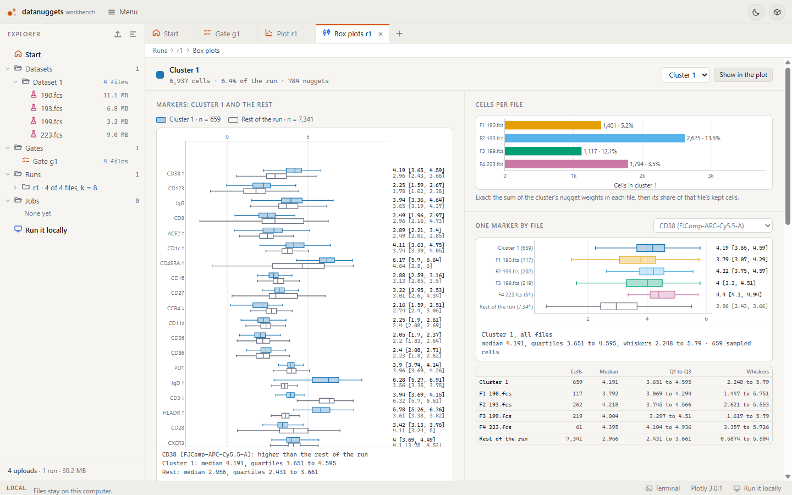
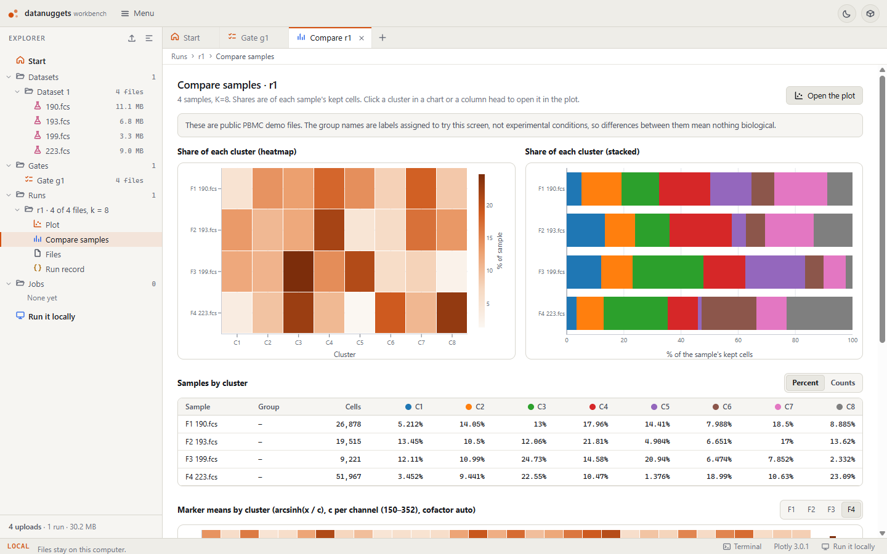

# datanuggets-flow

Explore flow cytometry populations across multiple FCS files with data nuggets.



The app's plot view shows a t-SNE of the data nuggets from four public PBMC demonstration files. Each point is sized by its nugget weight and colored by its cluster.

A flow cytometry experiment can produce millions of events across dozens of samples. Analyzing each file separately makes it hard to compare clusters across samples. Analyzing everything together can become expensive, especially when a method needs pairwise distances.

`datanuggets-flow` takes a middle route. It helps you select candidate populations in each file using forward and side scatter, reduces the selected events to weighted data nuggets and clusters the pooled nuggets in one analysis. The cluster labels are shared across the files in a run, so you can examine how their relative abundance and marker profiles differ between samples.

The package builds on [`datanuggets`](https://pypi.org/project/datanuggets/), a Python port of the R packages `datanugget` and `WCluster`. It offers a local web app, a command-line interface and a Python API.

> **Research alpha (`0.1.0a3`).** This is an exploratory analysis tool. It isn't an automated cell-type identification system or a validated clinical analysis system. Its clusters are mathematical groupings, and they aren't confirmed biological populations. The API and analysis defaults may change.

[Project page](https://ron2k1.github.io/datanuggetsflowcytometry/) · [App guide](https://github.com/ron2k1/datanuggetsflowcytometry/blob/main/docs/app/running-locally.md) · [Command reference](https://github.com/ron2k1/datanuggetsflowcytometry/blob/main/docs/cli.md) · [Python API](https://github.com/ron2k1/datanuggetsflowcytometry/blob/main/docs/api.md) · [Methodology](https://github.com/ron2k1/datanuggetsflowcytometry/blob/main/docs/methodology.md) · [Limitations](https://github.com/ron2k1/datanuggetsflowcytometry/blob/main/docs/limitations.md)

## Get started

### Use the local app

With Docker installed, run:

```sh
docker run --rm -p 127.0.0.1:8000:8000 -v datanuggets-data:/data ghcr.io/ron2k1/datanuggets-flow:0.1.0a3
```

Open <http://127.0.0.1:8000> in your browser. The app lets you inspect candidate gates, choose which populations to include, run the clustering and explore the results with interactive plots.

The address is bound to your own computer rather than your local network. The named Docker volume keeps uploads and completed runs between containers. The analysis runs on your computer. Downloading the container image itself requires a network connection. Check your environment's network and data-handling requirements before you use sensitive files.

The image includes a small public PBMC demonstration dataset of four FCS files, so you can explore the workflow before adding your own. The [app guide](https://github.com/ron2k1/datanuggetsflowcytometry/blob/main/docs/app/running-locally.md) covers the app's settings and building the image from source.



The population step shows each file's FSC-A and SSC-A density with the peaks the gate finder kept. You tick the populations to carry into the clustering.



The cluster step is where you set the number of clusters and how many nuggets each file keeps. You can also change the transform and the clustering method, and tick the marker channels to cluster on.

### Install from PyPI

The package requires Python 3.12 or newer and a platform that the underlying `datanuggets` package supports. Those are Windows x64, Apple silicon Macs running macOS 12 or newer, and Linux x86-64 or ARM64 with glibc 2.27 or newer. Install the pinned alpha:

```sh
python -m pip install "datanuggets-flow==0.1.0a3"
```

The package uses `datanuggets` for reduction and weighted clustering, `flowio` for FCS input, and pandas, matplotlib and scikit-learn for analysis and reporting.

### Run the command-line workflow

```sh
datanuggets-flow path/to/fcs_folder
```

The command finds candidate scatter populations in each FCS file, shows the gating figure and asks which populations to keep. It then runs a joint clustering analysis and writes the figures, tables and settings to a new output directory.

For a two-step workflow, use `--gates-only` to inspect the gates first and `--from-gates` to continue from saved gates. The [command reference](https://github.com/ron2k1/datanuggetsflowcytometry/blob/main/docs/cli.md) lists every option and output file.

### Run it from Python

The Python API exposes the same two stages. The first creates and saves the candidate gates. The second analyzes the populations you select.

```python
from pathlib import Path

from datanuggets_flow.pipeline import gate_stage, cluster_stage, parse_selection
from datanuggets_flow.settings import GateSettings, ClusterSettings
from datanuggets_flow.state import load_gates, write_run

files = sorted(Path("path/to/fcs_folder").glob("*.fcs"))
gates_dir = Path("outputs/gates-001")
run_dir = Path("outputs/run-001")

# Use new folders for every run, so one run's files never mix with another's.
gates_dir.mkdir(parents=True)
gate_stage(files, gates_dir, GateSettings())

# Examine outputs/gates-001/local_maxima.png before selecting populations.
gates = load_gates(gates_dir)
selected = parse_selection(
    "1,2",  # Example only: review the numbering in every file.
    [len(sample["stats"]) for sample in gates.samples],
)

run_dir.mkdir(parents=True)
settings = ClusterSettings(k=12)
result = cluster_stage(gates.samples, selected, run_dir, settings)

# Save run.json, the record of the run's settings.
write_run(
    run_dir, gates_dir, settings, selected,
    result.channels, result.labels,
    scaling=result.pool.scaling,
    cofactor=result.cofactor,
    pool=result.pool,
)
print(result.tables.summary)
```

The candidate populations are numbered separately for each file. Population 1 in one file isn't necessarily the same biological population as population 1 in another. The selection shown above is only an example. Inspect each gate before selecting it, and choose a cluster count appropriate for your experiment rather than assuming `k=12` is correct.

## What happens in an analysis?

The pipeline has two stages. The first decides which events to keep. The second clusters the selected events together.

1. **Read the FCS files.** Event values are read using `flowio`. The pipeline doesn't apply fluorescence spillover compensation. A file whose spillover matrix differs from the identity gets a warning, and the run goes on.
2. **Find candidate gates.** For each file, the gate finder works in the FSC-A/SSC-A plane after a square-root transformation. It uses a 100 by 100 density grid and local peaks to propose populations. These are candidates for review. They aren't verified lymphocyte, monocyte or other cell identities.
3. **Choose populations.** You decide which gates to retain in each sample. A candidate gate may overlap another, and events can lie outside every candidate gate. An event in two retained gates is counted once. `selection.csv` records how many events each file keeps.
4. **Transform and scale markers.** Retained channels are transformed with `arcsinh(x / c)` and standardized using pooled statistics, so values from the included files are mapped into a common feature space. By default the cofactor `c` is chosen per channel by a package heuristic. It doesn't come from the Data Nuggets paper.
5. **Create nuggets per file.** By default, the package targets up to 1,000 nuggets from the retained events in each file. In this pipeline, the default nugget center is an original selected event rather than a within-nugget mean. Each nugget also carries a weight describing how many events it represents and a scale describing within-nugget variability. The pipeline doesn't run the nugget refinement step used in the published flow cytometry example.
6. **Cluster once.** Nuggets from all files are combined. Weighted k-means is the default, and weighted Ward hierarchical clustering is an alternative. The nugget weights matter because a nugget representing hundreds of cells shouldn't count the same as one representing a single cell.
7. **Map results back to events.** The cluster assigned to a nugget is carried back to the original events represented by that nugget. The result is one common cluster-label system for the analyzed files.
8. **Explore and export.** The run produces per-file cluster counts and proportions, marker summaries, PCA scores and plots. Each proportion is a share of the events retained in that file. Check the denominator before comparing it with whole-file or conventional gated-population frequencies.

Pooled clustering gives every file the same labels. It doesn't prove that a label denotes the same cell type in every file. Differences in compensation, instrument settings, panels, batch effects or gating can change the placement of events in marker space.

The [methodology guide](https://github.com/ron2k1/datanuggetsflowcytometry/blob/main/docs/methodology.md) gives every rule and constant behind these steps.

## Explore the results

The app gives you several ways to inspect a finished run:

- **2D and 3D scatter plots** of nuggets or sampled cells, colored by the common cluster labels
- **Marker and PCA axes** to examine where clusters sit in measured or derived feature space
- **t-SNE views** for exploring local groupings, with separate two- and three-dimensional fits
- **Parallel-coordinate plots** for checking marker patterns across clusters
- **Per-cluster box plots and per-file comparison tables** for reviewing marker levels and cluster frequencies



This is the demonstration run as a 3D t-SNE, shown in the app's dark theme. You can rotate and pan the plot.



Marker axes put measured channels on the plot. This view has CD3, CD19 and CD14, and each axis has a menu for choosing another channel.

Nugget points can be sized according to their weights. A marker axis shows that channel's transformed values, so you can read a cluster's level and spread on the marker from the axis. PCA reports variation along weighted linear components. t-SNE offers a different view of local neighborhoods, but its visual gaps and apparent cluster sizes shouldn't be treated as quantitative distances or population sizes.



The box plot view compares a cluster's marker levels with the rest of the run. It also shows how many of the cluster's cells come from each file.



The compare view shows each cluster's share of every sample as a heatmap, a stacked bar chart and a table. Each share is a percentage of the events retained in that file.

For programmatic analysis, run outputs include cluster summaries and coordinate tables such as `pca_scores.csv`, `tsne.csv`, `tsne3d.csv` and `cells.csv`. The saved `run.json` records the settings used for the analysis.

## Research background

The method behind the reduction is described by Beavers et al. (2025). Data nuggets replace a large set of observations with a smaller collection of centers, weights and scales. The aim is to reduce computation while keeping the broad structure of the data, including its edges, which a random sample can miss. The paper demonstrates weighted PCA and weighted k-means on a flow cytometry dataset with 1,048,575 events, first reduced to 2,000 nuggets and then refined to 3,135. These are results from the published study.

The flow cytometry context is developed further in Dastgiri et al. (2026), which combines data nuggets with differential projection pursuit to find where cell populations differ most between experimental conditions. That work addresses an important limitation of manual two-dimensional gating. This package doesn't implement differential projection pursuit. It uses scatter-based gate selection, pooled nugget clustering and descriptive comparisons across files. These are distinct workflows and shouldn't be treated as equivalent.

Duan, Cabrera and Emir (2025) also develop projection pursuit for large datasets using data nuggets. That method searches for informative low-dimensional projections, and it's different from the PCA and t-SNE views included here. Pooled per-marker standardization also isn't the same operation as the multivariate spherization used in projection pursuit work. Cherasia et al. (2023) study data nuggets for supervised regression, which is outside this package's current clustering workflow.

The FSC/SSC candidate gate finder was adapted from Python code supplied by Prof. Javier Cabrera. Its thresholds and the package's choices about cofactors, per-file nugget creation, pooled scaling and cluster reporting aren't established by the Data Nuggets papers. The [methodology guide](https://github.com/ron2k1/datanuggetsflowcytometry/blob/main/docs/methodology.md#relation-to-the-papers) documents them, and they still need independent testing.

## Before interpreting a cluster

These checks matter more than a convincing-looking plot:

- **Review every gate.** Scatter-based gating may miss rare populations or include debris. It doesn't replace a complete experimental gating strategy, including singlet and viability checks where appropriate.
- **Handle compensation and unmixing upstream.** The package doesn't perform them. Fluorescence measurements from incompatible or incorrectly compensated files shouldn't be pooled without correction.
- **Confirm channel correspondence.** All files need compatible markers, channel identities and experimental measurement scales. Matching channel names isn't enough to establish biological equivalence.
- **Check overlap and denominators.** Candidate gates may overlap. An event in two retained gates is counted once, and each percentage is a share of the events retained in that file. Confirm that's the population you mean to compare. Different gate selections across files can themselves change the proportions you compare.
- **Run sensitivity analyses.** Compare different random seeds, nugget counts and cluster counts. A mathematical cluster can appear or disappear when these settings change.
- **Inspect marker profiles before naming cells.** Cluster IDs are arbitrary integers. Biological labels require marker interpretation, appropriate controls and, ideally, validation against expert analysis or independent samples.
- **Don't treat group comparisons as statistical tests.** Differences in cluster percentages are descriptive unless a separate inferential analysis accounts for participants, replicates and the experimental design.
- **Keep the preprocessing record.** Store the FCS files, gate selections, channel mappings, transformations, settings, package versions and the completed run folder together.

Weighted Ward clustering also requires memory quadratic in the pooled nugget count. A 10,000 by 10,000 float64 matrix alone takes approximately 800 MB, before other analysis allocations. The [limitations](https://github.com/ron2k1/datanuggetsflowcytometry/blob/main/docs/limitations.md) list the open problems.

## Reproducibility and scope

The nugget and weighted k-means implementations come from `datanuggets`. By default, nugget creation and the k-means starts draw from R's random number stream through `RDraws`, from seed `291102`. Even with a fixed seed, record the package versions and platform when comparing results.

The R packages implement the underlying reduction and weighted methods. This flow cytometry workflow adds its own gate finder, transformations, per-file reduction, plotting and reporting. The `datanuggets` port is tested against output from the R packages. That covers the numerical methods only. The steps this package adds haven't been validated against expert gating or independent samples, which is why this release is labeled a research alpha.

## Papers and acknowledgments

### Core method

Beavers, T. E., Cheng, G., Duan, Y., Cabrera, J., Lubomirski, M., Amaratunga, D., and Teigler, J. E. (2025). Data Nuggets: A Method for Reducing Big Data While Preserving Data Structure. *Journal of Computational and Graphical Statistics*, 34(1), 330-342. Published online in 2024. [doi:10.1080/10618600.2024.2341896](https://doi.org/10.1080/10618600.2024.2341896).

### Related research

- Dastgiri, M., Cabrera, J., Duan, Y., et al. (2026). Novel machine learning approach to differential cell flow cytometry analysis based on projection pursuit. *Journal of Biopharmaceutical Statistics*, 36(6), 1244-1256. Published online in 2025. [doi:10.1080/10543406.2025.2490725](https://doi.org/10.1080/10543406.2025.2490725).
- Duan, Y., Cabrera, J., and Emir, B. (2025). A New Projection Pursuit Index for Big Data. *Journal of Computational and Graphical Statistics*, 34(4), 1566-1577. [doi:10.1080/10618600.2025.2468791](https://doi.org/10.1080/10618600.2025.2468791).
- Cherasia, K. E., Cabrera, J., Fernholz, L. T., and Fernholz, R. (2023). Data Nuggets in Supervised Learning. In M. Yi and K. Nordhausen (eds.), *Robust and Multivariate Statistical Methods: Festschrift in Honor of David E. Tyler* (pp. 429-449). Springer. Published online in 2022. [doi:10.1007/978-3-031-22687-8_20](https://doi.org/10.1007/978-3-031-22687-8_20).

The data nugget reduction and weighted clustering methods belong to their original researchers and the maintainers of the R `datanugget` and `WCluster` packages. `datanuggets-flow` builds on the [`datanuggets`](https://github.com/ron2k1/datanuggets) Python port. The scatter gate finder adapts Python code supplied by Prof. Javier Cabrera. The [third-party notices](https://github.com/ron2k1/datanuggetsflowcytometry/blob/main/THIRD_PARTY.md) record the permissions and the upstream licenses.

The demonstration files in the app and the recorded test data come from Stefanie Kreutmair and Susanne Unger (2026), *Flow cytometry data of PBMC of critically ill, mechanically ventilated patients* (V1), Zenodo, [doi:10.5281/zenodo.22079206](https://doi.org/10.5281/zenodo.22079206).
